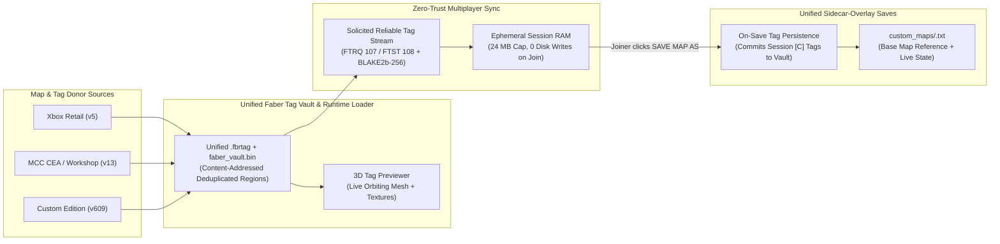

<div align="center">

# OpenCE : Forge

**Halo: Combat Evolved for Windows, Linux & Android — Full [OpenCE](https://github.com/OpenCommunityEdition/OpenCE) Port with Integrated 3D Forge Mode (`v2.10.6`)**

<p align="center">
  
</p>

[](https://github.com/SutlabSol/OpenCE-Forge/releases/latest)
[](https://github.com/OpenCommunityEdition/OpenCE)
[](LICENSE)

[**Download Latest Release**](https://github.com/SutlabSol/OpenCE-Forge/releases/latest) ·
[Overview](#overview--unified-opence-integration) ·
[Architecture](#architecture-overview) ·
[Forge Menu & Tag Vault](#forge-menu--unified-tag-vault) ·
[In-Game Features](#in-game-forge-features) ·
[Security & Zero-Trust Streaming](#security-architecture--zero-trust-custom-tag-streaming-ftrq--ftst) ·
[Controls](#controls-in-forge) ·
[Building](#building-from-source)

</div>

---

## Overview — Unified OpenCE Integration

**OpenCE : Forge** builds on [**OpenCE** (Open Community Edition)](https://github.com/OpenCommunityEdition/OpenCE), the native C port of the Halo: Combat Evolved Xbox decompilation (`01.01.14.2342`).

**Forge Mode is natively integrated directly into `halo.exe`** alongside the complete Campaign, Standard Multiplayer, Online Co-Op, MCC Map Support, and Mods experience:

- **Full Campaign & Standard Multiplayer Intact:** Play solo or online Co-Op Campaign, browse the 128-player Internet/LAN Server Browser, play SWAT, Infection, Gun Game, or Hardcore, and load Mods or MCC Workshop packages from the main menu just like upstream OpenCE.
- **Unified `SELECT GAMEMODE` Multiplayer Hub:** Selecting **Multiplayer** on the main menu opens the **Select Gamemode** screen with two modes and live right-panel artwork/descriptions:
  - **STANDARD:** Normal OpenCE Multiplayer (Internet Server Browser, LAN, Split-Screen, Create Game). Standard sessions use stock OpenCE network protocol versioning so Forge builds can join stock OpenCE servers seamlessly.
  - **FORGE:** Opens the dedicated Forge Hub (**Solo Forge**, **Multiplayer Forge**, **Edit Maps**, and **Tag Options**).
- **Forging on Xbox, Custom Edition & MCC Multiplayer Maps:** Edit any retail Xbox multiplayer map, Halo Custom Edition multiplayer map (`custom_maps/`), or Halo 1 MCC multiplayer/Workshop map (`mcc_maps/`). *(Singleplayer campaign maps can be opened in the Tag Browser to extract custom tags, while map editing is restricted to multiplayer maps.)*
- **Unified Faber Tag Vault (`.fbrtag` + `faber_vault.bin`):** Custom tags extracted from **Xbox**, **MCC**, and **Custom Edition** maps are stored in a single unified, content-addressed, deduplicated storage format (`tag_profiles/*.fbrtag` + `tag_profiles/faber_vault.bin`). Shared bitmaps and sound permutations across multiple custom tags are stored once in `faber_vault.bin` and paged on demand.
- **Unified Sidecar Map Saving (`F5` / `Pause -> SAVE MAP..`):** Saving a forged map exports a lightweight `.txt` sidecar overlay in `custom_maps/` storing all placed objects, spawns, objectives, weld groups, light overrides, and custom tag references so forged maps play natively in both Forge and Standard Mode Multiplayer and Dedicated Servers without duplicating large `.map` files.

> [!IMPORTANT]
> **Network Protocol & Stock Session Isolation:** Standard (non-Forge) multiplayer sessions continue to advertise and validate OpenCE's stock `HALO_PORT_NETWORK_VERSION` via [`forge_get_network_version`](port/linux/game/forge_runtime_tags.c), while active Forge sessions use `FORGE_NETWORK_VERSION` (`0x462A`) and `FORGE_GAME_KIND` (`0x46`) in [`forge_engine.h`](port/linux/game/forge_engine.h). Stock OpenCE clients and servers remain 100% compatible with non-Forge games.

> [!NOTE]
> **No proprietary game maps or copyrighted assets are included in this repository or its releases.** You must provide your own Halo: Combat Evolved `maps/` (or Xbox `.iso` / `.xiso` disc image), optional Halo Custom Edition `custom_maps/` (`bitmaps.map`, `sounds.map`, `loc.map`), and optional MCC `mcc_maps/`.

---

## Architecture Overview



---

## Forge Menu & Unified Tag Vault

Navigating to **`MULTIPLAYER -> FORGE`** opens the Forge Hub:

1. **SOLO FORGE:** Choose any Xbox Multiplayer, Custom Edition Multiplayer, MCC Multiplayer, or saved Forge map (`FORGE MAPS` tab) and load directly into an endless single-player Forge editing session.
2. **MULTIPLAYER FORGE:** Host an Internet, LAN, or Split-Screen collaborative Forge lobby where up to 16 players can toggle between **343 Guilty Spark Monitor** (`F1`) and **Spartan** in real time and build together.
3. **EDIT MAPS:** Browse, rename, or delete **User Created** and **Downloaded** Forge maps with preview bitmaps and author metadata.
4. **TAG OPTIONS:** Complete in-menu tag extraction and cache management suite across Xbox, MCC, and Custom Edition maps:
   - **`ADD TAGS`:**
     - Opens a Map Picker (`RETAIL / XBOX`, `CUSTOM SINGLEPLAYER`, `CUSTOM MULTIPLAYER`, and `MCC MAPS`) for browsing any installed map.
     - Selecting any map opens the **Map Tag Browser** across 6 categories (`SCENERY`, `VEHICLES`, `BIPEDS`, `DEVICES`, `WEAPONS`, `EQUIPMENT`).
     - Features a **live rotating 3D wireframe model preview** on the right-hand panel along with `- <tag name>`, `- <tag type>`, and `- <tag size>`.
     - Pressing **`CHOOSE`** prompts you to enter a custom Forge menu name (`[C] <your_name>`), converts MCC/Xbox/CE geometry, shaders, bitmaps, and sounds as needed, and stores the tag and its full dependency closure into the deduplicated **Faber Tag Vault** (`tag_profiles/*.fbrtag` + `tag_profiles/faber_vault.bin`).
   - **`INSTALLED TAGS`:**
     - Browse all tags currently installed in your cache across all categories with the live rotating 3D preview and byte size breakdown.
     - Choosing any tag opens a confirmation dialog allowing you to **delete** individual tags from the vault.
   - **`RESET STOCK TAGS` / `RESET CUSTOM TAGS`:**
     - Confirmation dialogs (`CONFIRM` / `BACK`) to rebuild or clear stock cached tags or custom `[C]` tags independently.

---

## In-Game Forge Features

### 1. 3D Monitor Mode (`F1`) & Precision Manipulation
- **Instant Spartan ↔ Monitor Toggle (`F1` / D-Pad Up):** Seamless transition between playing as a Spartan and flying as 343 Guilty Spark Monitor with 1st/3rd-person view toggle (`F4`) and adjustable fly speed (`Shift`).
- **Line-of-Sight Raycast Selection & Push/Pull Distance:** Accurately select, grab, move, and place visible objects within **20m** (never through walls); use the **Mouse Wheel** (or `Page Up` / `Page Down`) to push/pull held objects smoothly between **1m and 30m**.
- **Hover or Hold Object Properties (`X`):** Open **Object Properties (`X`)** either while holding an object or simply while facing/hovering an object (so you can edit weld groups, physics modes, or light settings without disturbing placement).
- **3-Axis Gimbal Rotation & Snapping:** Hold **`R`** + Mouse (or `LT` on controller) to rotate Yaw and Pitch (`Q` / `E` rolls when holding `R`). Press **`G`** to cycle rotation snap increments (`Off -> 15° -> 45° -> 90°`), hold **`Z`** to snap to the floor, or hold **`F`** to snap to any surface.

### 2. Tabbed Object Palette (`F2`) & Live 3D Previews
- Spawn **Weapons**, **Equipment**, **Vehicles**, **Scenery**, **Doors / Barriers**, **Lights**, **Spawns & Objectives**, and **Custom (`[C]`) Tags** with an interactive 3D preview window.
- **Playable Multiplayer Covenant Wraith:** Includes an indestructible, multiplayer-ready Covenant Wraith in the Vehicles menu with a functional parabolic plasma mortar and wing-mounted plasma cannons.

### 3. Multi-Part Group Welding (`Ctrl+G` / `X -> WELD GROUP`)
- **Multi-Part Welding (`Ctrl+G`):** Link up to **64 objects** into a rigid weld group (`GROUP 1..16`, cycle active group with `Shift+Ctrl+G` or assign directly via `X -> WELD GROUP` while facing or holding an item).
- Grabbing, rotating (`R`), duplicating (`C`), or deleting any member manipulates the entire welded assembly while preserving exact relative local-space transforms.

### 4. Dynamic Runtime Lights (`F2 -> LIGHTS`)
- Spawn light fixtures and emitters from **`F2 -> LIGHTS`** and customize **LIGHT COLOR** (`DEFAULT`, `WHITE`, `RED`, `BLUE`, `GREEN`, `AMBER`, `PURPLE`, `CYAN`), **INTENSITY** (`100%`, `25%`, `50%`, `150%`, `200%`, `300%`), and **LIGHT RADIUS** (`DEFAULT`, `2U`, `4U`, `8U`, `12U`, `20U`) via **Object Properties (`X`)**.

### 5. Gametype Objectives, Teleporters & 3D Boundary Markers
- Existing and newly placed **Player Spawns**, **CTF Flags**, **Oddball Spawns**, **King of the Hill Zones** (with live 3D boundary rings), **Race Track Points**, and **Teleporters** render as 3D markers in Monitor Mode and can be moved, rotated, or configured in real time.

### 6. In-Session Peer-to-Peer Custom Tag Streaming
- When a host spawns a custom `[C]` tag that a connected client does not have installed, Forge automatically streams the compressed tag bundle over the reliable distributed channel with a live HUD progress bar and BLAKE2b-256 verification.
- Streamed tags install into a sandboxed **session-ephemeral RAM slot** (`24 MB` session cap, zero disk writes during gameplay) and are only committed to the client's local Faber Tag Vault if the client explicitly saves the Forge map (`F5` / `Pause -> Save Map`).

---

## Security Architecture & Zero-Trust Custom Tag Streaming (`FTRQ` / `FTST`)

When a client joins a Forge server whose map uses custom `[C]` tags not yet in the joiner's vault, the client streams those tags from the host under a strict **zero-trust security model** ([`forge_network.c`](port/linux/game/forge_network.c), [`forge_runtime_tags.c`](port/linux/game/forge_runtime_tags.c)):

| Security Control | Enforcement Mechanism |
| :--- | :--- |
| **User Opt-Out Setting** | Gated by `network.forge_tag_download` (`HALO_FORGE_TAG_DOWNLOAD`, default `true`) in [`port_config.c`](port/linux/src/port_config.c). When disabled, clients never request or accept tag streams and render lightweight 3D proxy markers instead. |
| **Reliable-Stream Admission Only** | [`forge_tag_stream_handle_message`](port/linux/game/forge_network.c) rejects any packet where `from_stream == FALSE`, preventing unauthenticated UDP datagram spoofing or injection. |
| **Solicited Single-Flight Transfer Tokens** | Clients only accept `OFFER` and `CHUNK` packets matching the currently solicited `hash` and a randomized 32-bit `transfer_id` token (`g_client_tag_rx.transfer_id`). Unsolicited offers or mismatched tokens are rejected immediately. |
| **Strict Tag Group & Path Allowlisting** | Only placeable object root groups (`scen`, `vehi`, `weap`, `eqip`, `mach`, `lifi`, `ctrl`, `bipd`) are permitted. Rejects non-ASCII characters, drive letters (`:`), leading/trailing/double slashes, and `..` path traversal sequences, and verifies `FNV-1a(group, tag_path) == expected_hash` against bait-and-switch offers. |
| **Cryptographic BLAKE2b-256 Pre-Parse Verification** | All chunks are reassembled with duplicate/out-of-bounds bitmap tracking (`chunk_seen[]`), inflated with exact size verification (`forge_zlib_uncompress_exact`), and verified in constant time against the offer's **BLAKE2b-256** digest **before** any tag or bundle parser ever touches the payload. |
| **Base-Map Anti-Shadowing** | [`forge_install_ephemeral_tag_bundle`](port/linux/game/forge_runtime_tags.c) refuses to install any streamed tag whose `(group, path)` matches a tag already present in the base map (`abs_index < forge_get_base_map_tag_count()`), preventing a malicious host from overriding stock game assets. |
| **Bounded Session RAM & Strike Cutoff** | Enforces per-bundle caps (`<= 8 MB` compressed, `<= 14 MB` uncompressed), a `24 MB` per-session RAM cap (`FORGE_TAG_STREAM_MAX_SESSION_BYTES`), a 32-tag session limit, and a **3-strike host cutoff** (`FORGE_TAG_STREAM_MAX_STRIKES = 3`) that halts all tag streaming from a misbehaving peer. |
| **Backlog & Rate Pacing** | Host transmission in [`forge_tag_stream_tick`](port/linux/game/forge_network.c) is gated by per-client `reliable_outgoing_queue` backlog (`<= 16 KB`) and a `128 KB/s` wall-clock token bucket so high-FPS hosts never starve gameplay traffic or overflow the 256 KB reliable queue. |
| **Zero Disk Writes Unless Explicitly Saved by Joiner** | Streamed tags live exclusively in session RAM (`source_cache_id = 4`) and are wiped on map unload unless the joiner explicitly chooses `SAVE MAP AS` (or `F5`). When the joiner saves the map, [`forge_commit_session_ephemeral_tags_to_disk`](port/linux/game/forge_runtime_tags.c) persists the already-verified session bundles into the unified Faber Tag Vault (`.fbrtag` + `faber_vault.bin`) so the saved Forge map works offline on future boots. |

---

## Dedicated Server Support

- Dedicated server rotation `<map>:forge` entry ([`docs/dedicated_server.md`](docs/dedicated_server.md)) and flags `--forge-map <map>` and `--forge-autosave` ([`server_mode.c`](port/linux/src/server_mode.c), [`forge_server_autosave_tick`](port/linux/game/forge_runtime_tags.c)) flush a lightweight `.txt` sidecar 5 seconds after edits and commit full state when the last player leaves or via `!FW`.

---

## Installation

| Platform | Release Download | Debug Download |
| :--- | :--- | :--- |
| **Windows (x86)** | [**OpenCE-Forge-v2.10.4-windows-x86.zip**](https://github.com/SutlabSol/OpenCE-Forge/releases/latest/download/OpenCE-Forge-v2.10.4-windows-x86.zip) / [halo-windows-release.zip](https://github.com/SutlabSol/OpenCE-Forge/releases/latest/download/halo-windows-release.zip) | [halo-windows-debug.zip](https://github.com/SutlabSol/OpenCE-Forge/releases/latest/download/halo-windows-debug.zip) |
| **Linux (x86)** | [halo-linux-release.zip](https://github.com/SutlabSol/OpenCE-Forge/releases/latest/download/halo-linux-release.zip) | [halo-linux-debug.zip](https://github.com/SutlabSol/OpenCE-Forge/releases/latest/download/halo-linux-debug.zip) |
| **Android (ARM64)** | [halo-android-release.zip](https://github.com/SutlabSol/OpenCE-Forge/releases/latest/download/halo-android-release.zip) | [halo-android-debug.zip](https://github.com/SutlabSol/OpenCE-Forge/releases/latest/download/halo-android-debug.zip) |

### Quick Start (Windows / Linux)
1. Download the latest release archive from the [**Releases**](https://github.com/SutlabSol/OpenCE-Forge/releases/latest) page and extract it to a folder.
2. Place your Halo Xbox `maps/` folder (or Halo Xbox `.iso` / `.xiso` disc image) next to `halo.exe` (`halo` on Linux), along with your optional `custom_maps/` (`bitmaps.map`, `sounds.map`, `loc.map`, and Custom Edition `.map` files) and `mcc_maps/` folders.
3. Launch **`halo.exe`**.
4. Select **`MULTIPLAYER -> FORGE`** to start forging or manage custom tags under **`TAG OPTIONS`**.

---

## Controls in Forge

All Forge keyboard/mouse and controller bindings can be customized in-game under **`SETTINGS -> CONTROLS SETUP -> FORGE / FORGE PAD`**.

| Key / Input | Controller Default | Action |
| :--- | :--- | :--- |
| **`F1`** | **D-Pad Up** | Switch Play (Spartan) / Edit (3D Monitor) Mode |
| **`F2`** | **X** *(when not targeting item)* | Open / Close Inventory (Forge Object Palette) |
| **`X`** | **X** *(while holding or facing item)* | Open Object Properties (Physics, Respawn, Weld Group, Lighting) |
| **`Left Click`** | **A** | Grab / Drop Object |
| **`Mouse Wheel`** | **`Page Up` / `Page Down`** | Push / Pull Held Object (`1m` – `30m`) |
| **`Delete` / `Backspace`** | **Y** | Delete Hovered / Held Object (or Weld Group) |
| **`Hold R` + Mouse** | **Hold Left Trigger (LT) + RS** | Rotate Held / Hovered Object (`Q` / `E` rolls while holding `R`) |
| **`Ctrl+G`** | **Object Properties -> Weld Group** | Toggle Weld Membership in Active Weld Group (`1..16`; `Shift+Ctrl+G` cycles group) |
| **`C`** | **D-Pad Right** | Duplicate Hovered Object (or entire Weld Group) |
| **`G`** | **Right Thumb (RS)** | Cycle Rotation Snap (`Off`, `15°`, `45°`, `90°`) |
| **`Hold Z`** | **D-Pad Left** | Snap held object to floor |
| **`Hold F`** | **—** | Snap held object to surface |
| **`F4`** | **Back** | Toggle 1st-Person / 3rd-Person Monitor View |
| **`F5`** | **D-Pad Down** | Quick Save Forge Map (`custom_maps/<name>.txt`) |
| **`Ctrl+Z` / `Ctrl+Y`** | **—** | Undo / Redo Forge Action |

---

## Building from Source

```powershell
python configure.py --release
ninja windows      # build/windows/halo.exe and SDL3.dll
ninja linux        # build/linux/halo
ninja android_apk  # port/android/app/build/outputs/apk/debug/app-debug.apk
```

If you modify menu definitions in `tools/ce_menus.py` or `tools/port_settings.py`, regenerate the embedded menu XML before building:
```powershell
python tools/port_settings.py
```

---

## Licence & Credits

- **OpenCE : Forge** is developed by **Mota-Lev** on top of [OpenCommunityEdition/OpenCE](https://github.com/OpenCommunityEdition/OpenCE) ([bnunu/halo-1](https://github.com/bnunu/halo-1) / [punpckhdq/halo](https://github.com/punpckhdq/halo)).
- High-resolution HUD and menu art redraws are credited in [AUTHORS.md](AUTHORS.md).
- Licensed under the [GNU Affero General Public License v3.0 or later (`AGPL-3.0-or-later`)](LICENSE).
